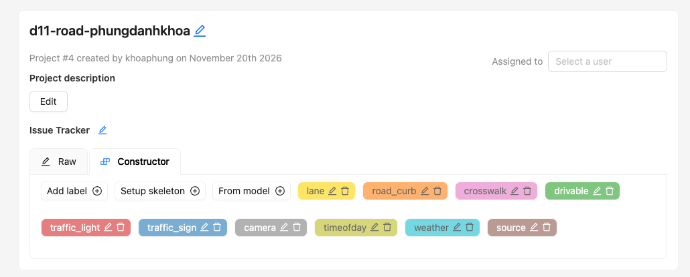

# Báo cáo cá nhân — Ngày 11

**Học viên** Phùng Danh Khoa (2A202603206)  
**CVAT** 2.74.1 · project `d11-road-phungdanhkhoa`  
**Guideline** Road v1.0 · **Bản bàn giao** revision 5  
**Export từ CVAT** 21/11/2026, 11:23 ICT  
**Phạm vi** 20 ảnh bắt buộc và 8 ảnh thêm. Có hỗ trợ của Codex trong lượt đối chiếu ảnh gốc, chỉnh nhãn, xuất file và rà hồ sơ.

**Tình trạng bàn giao** Đã áp dụng hướng dẫn của coach do học viên chuyển lại: khi không thấy vạch thì không gán. Sáu cảnh báo QC1-02 được giải trình theo từng phía ở mục 4.

## 1. Kiểm project

| Mục | Kết quả | Ghi chú |
| --- | --- | --- |
| 6 label vẽ | Đủ | `lane`, `road_curb`, `crosswalk`, `drivable`, `traffic_light`, `traffic_sign` có đúng kiểu hình trong project. |
| 4 tag ảnh | Đủ | Mỗi ảnh có một `camera`, `timeofday`, `weather` và `source`. Camera đúng hậu tố ảnh ở cả hai bộ. |
| Trạng thái job | Completed | Job 24, 25, 26 và 27 đã được đọc lại sau lượt sửa. |

Khi vẽ polyline, nhấn `N` để kết thúc. Với tag, chọn công cụ Tag, chọn label, rồi mở Details để kiểm giá trị `value`.

## 2. Số lượng đã gán

| Task | Ảnh | lane | road_curb | crosswalk | drivable | traffic_light | traffic_sign |
| --- | ---: | ---: | ---: | ---: | ---: | ---: | ---: |
| front | 12 | 28 | 4 | 6 | 23 | 33 | 24 |
| front-extra | 4 | 10 | 1 | 2 | 8 | 7 | 11 |
| fisheye | 8 | 7 | 10 | 9 | 7 | 8 | 5 |
| fisheye-extra | 4 | 0 | 3 | 4 | 4 | 0 | 0 |
| **Tổng** | **28** | **45** | **18** | **21** | **42** | **48** | **40** |

B11 chỉ có bốn tag. Ảnh cho thấy các ô đỗ xe, gồm ô dành cho người khuyết tật. Không tính B11 là ảnh bonus đạt.

## 3. Bảng ca khó

| Ảnh | Nhãn | Điều cần phân biệt | Quyết định trong revision 5 | Dấu hiệu trên ảnh |
| --- | --- | --- | --- | --- |
| A03 | lane R1 | Vạch đứt với đoạn sơn bị gián đoạn tại chữ mặt đường | Bật cờ CVAT `occluded` và dùng một polyline | Vệt dọc thấy được ở hai đầu đoạn có chữ sơn ngang. |
| A06 | lane L1 | Vạch dọc sau giao lộ và vạch ngựa vằn | Gán đoạn vàng đôi nhìn thấy cho L1 | Hai nét sơn song song chạy dọc hàng xe bên trái, từ ngay sau dải vạch qua đường. |
| A07 | drivable direct | Ranh làn và xe đứng trước | Kéo vùng lái qua xe bạc, giữa dải chắn và vạch trắng rõ | Thấy dải chắn và vạch phải cả trước lẫn sau phần xe che. |
| A09 | lane và road_curb | Vạch trắng đứt ở giữa đường và mép phải | Giữ vạch trắng ở phía trái của làn trực tiếp đang gán và chỉnh mép phải theo lề | Vạch đứt có vệt sơn nhìn thấy. Ở phía phải vùng direct chỉ nhận diện được mép lề trong bóng, không thấy vạch dọc riêng. |
| A09 | traffic_sign | Biển thật với nhóm khó đọc | Gán hai tấm biển ven đường với `group=other` | Thấy đủ biên tấm biển, chữ bị mờ và nằm trong bóng. |
| A10 | traffic_sign | Một cụm trên cột và từng tấm biển | Ba box riêng cho ba tấm cấm dừng/đỗ sát nhau, thêm box cho tấm cấm ở phía xa | Ba tấm gần có đường biên và nội dung riêng. |
| B01 | traffic_light | Hướng và màu của cụm đèn tối | Bổ sung hai box, màu `unknown`, một mặt sau và một nhìn xiên | Thấy vỏ đèn; góc nhìn và độ tối hạn chế xác định trạng thái. |
| B03 | lane R1 | Vệt cong gần xe và khoảng trống giữa các đoạn sơn | Đặt điểm dày ở vệt gần, nối tới vệt xa trong một polyline | Tâm vệt cong đổi hướng ở đoạn gần ảnh. |
| B11 | lane | Vạch ô đỗ và vạch làn lưu thông | Giữ bốn tag; không gán vạch ô đỗ | Các vạch bao ô đỗ và ký hiệu người khuyết tật. |

## 4. Phiếu QC1 nhận được và lượt sửa

Nguyễn Công Quý kiểm revision 1 và kết luận **Rework** với 5 lỗi chính trên 83 nhãn trong mẫu. [Phiếu nhận được từ Quý](https://github.com/nguyencongquy/K5-L23-Day11-2A202603149-NguyenCongQuy-Road-Elements-SVM/blob/6573ff4bc51c3d6369202f0de36059c963cd6991/nguyencongquy-qc1-for-phungdanhkhoa.md)

| Mã | Lỗi nhận được | Xử lý ở revision 3 |
| --- | --- | --- |
| QC1-07 | A08, ranh trái của vùng lái cắt chéo lòng đường | Giữ phần sửa revision 2 sau khi đối chiếu lại với vạch L1 trên CVAT. |
| QC1-04 | A09, đuôi L2 đi quá đoạn sơn thấy được | Giữ điểm dừng đã rút về khoảng (459,458). Chỉnh riêng đường mép lề và ranh phải vùng lái. |
| QC1-07 | A10, vùng lái dừng ngay sau xe | Kéo vùng lái tiếp về phía xe cứu thương trong hành lang dựa trên hai rìa thấy được. Bổ sung đoạn R1 còn nhìn rõ trên mặt đường ướt. |
| QC1-11 | B03, bỏ sót đoạn đứt gần xe | Vẽ lại các điểm theo tâm sơn ở đoạn gần và giữ một polyline xuyên qua khoảng đứt. Chỉnh ranh phải vùng lái theo R1 và thêm vạch R2 thấy được. |
| QC1-07 | B05, polygon tràn lên vỉa hè | Hạ biên xa xuống mép vệt sơn ngoài cùng. |

Lượt rà soát cũng chỉnh vùng lái ở A07 và A14, vạch đứt R2 ở A07, hộp đèn B01, mép đường B07 và vùng lái B08, B12. Hai cảnh báo của revision 2 đã được xử lý bằng việc bổ sung A06 L1 và A10 R1. Revision 4 bỏ hộp gán nhầm đèn nóc xe tải ở A07 và bổ sung ba cụm đèn giao thông tại đó. Ở A09, bản này bổ sung cụm đèn xanh, hai cụm nhìn nghiêng và hai tấm biển ven đường. Revision 5 rà checkpoint A03 và B02. A03 bật `occluded` trên R1, B02 chỉnh độ sát hai hộp có sẵn và bổ sung ba hộp đèn nhìn rõ. Theo hướng dẫn coach mà Phùng Danh Khoa chuyển lại ngày 21/11/2026, vị trí không thấy vạch thì để trống. Bảng dưới đây ghi kết luận của lượt tự QC trên ảnh gốc khi áp dụng hướng dẫn đó.

| Ảnh | Phía lint báo thiếu | Lý do để trống |
| --- | --- | --- |
| A05 | L1 | Không thấy vạch sơn dọc trên mặt đường phía trái. Xe đỗ che một phần lề. |
| A05 | R1 | Mốc nhìn thấy bên phải là mép đường và hàng xe đỗ. Phần mặt đường nhìn được không có vạch dọc riêng. |
| A06 | R1 | Nét sơn trắng nhìn thấy nằm ngoài hàng cột về phía lề. Trong hành lang của xe chụp không thấy vạch dọc xác định ranh phải. |
| A07 | L1 | Dải chắn bê tông và đường tiếp giáp với mặt đường thể hiện ranh trái. Không thấy vạch sơn riêng dọc chân dải chắn. |
| A09 | R1 | Bên phải vùng direct là mép vỉa hè và bóng đổ. Vạch trắng đứt nhìn rõ nằm bên trái vùng direct. |
| A14 | R1 | Nét sáng phía phải nằm sát biên lề trong tối. Không nhận diện được một vạch sơn dọc riêng, nên giữ nhãn mép lề và để trống R1. |

## 5. Kiểm file export

| File | Mở bằng `road_check lint` | Ảnh đầu, số shape CVAT / XML | Ảnh thứ hai, số shape CVAT / XML | Tag camera trong XML |
| --- | --- | ---: | ---: | --- |
| `phungdanhkhoa-front.zip` | Có · 16 ảnh | A01 · 8 / 8 | A02 · 7 / 7 | `front` |
| `phungdanhkhoa-fisheye.zip` | Có · 12 ảnh | B01 · 6 / 6 | B02 · 10 / 10 | `fisheye_front` |

Hai ZIP chỉ chứa `annotations.xml`. Hai task mỗi nhóm được ghép theo cấu trúc metadata dạng task của export gốc. Đã đối chiếu hình, tag và thuộc tính với bốn export task. Thư viện import cài trong CVAT đọc lại được cả hai ZIP, gồm 221 mục front và 105 mục fisheye (shape và tag). Manifest revision 5 có `contains_images=false` cho cả hai ZIP, cùng SHA-256 và số byte. Lint ghi **6 cảnh báo QC1-02 mức nặng, 0 chính, 0 nhẹ**. Sáu cảnh báo là các vị trí không thấy vạch được giải trình ở mục 4 theo hướng dẫn coach. Chưa có GT để tính sai số đường tâm hoặc điểm theo rubric.

## 6. Ảnh chụp màn hình

**Labels của project trong CVAT**



**A08 trong CVAT sau khi kiểm lại** · làn, vùng lái, đèn và biển.

Ảnh chụp A08 được lưu trong bộ minh chứng cục bộ để đối chiếu trên kênh lớp.

**B03 trong CVAT sau khi lưu** · hai polyline theo vạch đứt và ranh vùng lái.

Ảnh chụp B03 được lưu trong bộ minh chứng cục bộ để đối chiếu trên kênh lớp.

**Đoạn XML A10** · R1 trong ZIP front của revision 5.

```xml
<polyline label="lane" source="manual" occluded="0" points="1166.00,648.00;1123.00,620.00;1080.00,592.00;1045.00,569.00;1007.00,546.00;974.00,525.00" z_order="0">
  <attribute name="position">R1</attribute>
  <attribute name="style">dashed</attribute>
  <attribute name="color">white</attribute>
  <attribute name="kind">single</attribute>
</polyline>
```

## 7. Tự đánh giá

QC1-07 là lỗi lặp lại nhiều nhất trong phiếu nhận được. Khi rà một vùng lái có xe phía trước, cần xác định hai rìa làn ở chỗ còn thấy được rồi suy ra phần nằm dưới xe, đồng thời giữ biên trong mặt đường và ngoài thân xe chụp.

Ở B03, bổ sung đoạn vạch gần camera giúp các hàng neo phía gần có tọa độ x thay vì bị ghi thành hàng trống. Rà tâm sơn ở đoạn cong trước khi nối qua phần đứt giúp giảm sai số vị trí mà mô hình học.
